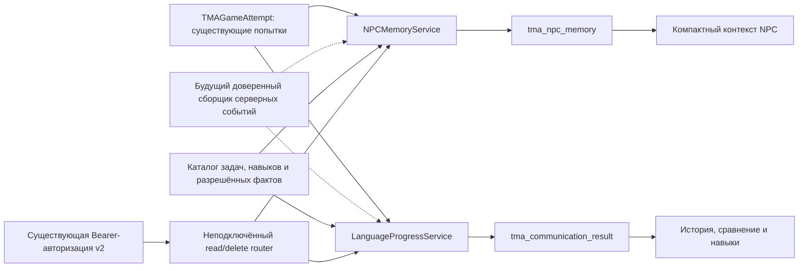

# Lerne — Game Mode MVP 3: исторический отчёт foundation

Этот текст описывает исходную двухтабличную реализацию и её исторические проверки.
В интеграционной копии он больше не является текущим отчётом о состоянии кода.
Актуальная подготовка и безопасное включение: [GAME_MODE_MVP3_INTEGRATION.md](GAME_MODE_MVP3_INTEGRATION.md).
Полный неизменённый исходник и SHA-256 manifest сохранены в [mvp3_source_snapshot](mvp3_source_snapshot/manifest.json).

Дата: 12 октября 2026. Ветка: `codex/game-mode-mvp3`.
Реализация находится в отдельном worktree. Интеграция с активной игрой отключена.
Миграция 88 подготовлена и протестирована на временной SQLite, к рабочей БД не применена.
Commit/push не выполнялись.

## 1. Архитектура

«Мир не меняется. Меняешься ты». Игровой результат остаётся решением существующего
движка. Новые сервисы сохраняют проверяемые сведения, не изменяя сцену или ответы NPC.



Пунктир обозначает будущую интеграцию. Сейчас никто в активном игровом цикле не вызывает
эти сервисы. NPC Memory не импортирует Language Progress и не получает его оценки.
Classic/SRS/Knowledge не читаются и не изменяются новыми сервисами.

В `api/main.py`, `api/models.py`, существующих игровых маршрутах/сервисах, GameView,
useGameVoice, STT/TTS и конфигурации Frau Müller изменений нет. Нет фоновых задач,
новых npm/Python зависимостей, Dexie-таблиц, вызовов ИИ или запуска сервера.

## 2. Анализ существующей архитектуры и переиспользование

| Источник | Уже имеется | Использование в MVP 3 |
| --- | --- | --- |
| `TMAGameAttempt` / `api/services/game_service.py` | UUID, владелец, NPC, situation_id, серверная сцена, outcome, hint_count, clarification_count, version, UTC-даты | Источник фактов и внешний ключ обеих новых таблиц |
| `TMAGameAttempt.history` | Последние 24 сообщения; полный архив отсутствует | Проверка точного цитатного свидетельства; история не копируется |
| `api/services/game_scene.py` | Сервер определяет каталог, выдачу и целевой результат | outcome берётся из записи попытки; модель не определяет успех |
| `api/game_config/library.json` | NPC, язык de, ситуация library_balcony_book_v1 | Совместимый идентификатор стартовой задачи; активная конфигурация не меняется |
| `api/auth/dependencies.py` | get_authenticated_user_id и строгий Bearer v2 | Та же авторизация на каждом подготовленном HTTP-маршруте |
| `TMAProgress`, `TMAReviewHistory`, `api/srs.py` | Расписание повторений, оценки карточек | Не используются как доказательство коммуникации |
| `TMAKnowledgeAttempt`, `knowledge_mastery.py` | evaluation_data, client_event_id, self_rating/hybrid и числовая mastery projection | Семантика несовместима с качественными коммуникативными свидетельствами; записи туда не добавляются |
| `knowledgeCaptureService.js` / exercise feedback | Ошибки, attempt_count, mistake_count, first_try_correct, completion | Относятся к упражнениям Classic, не к свободной речи |
| `knowledge_diagnostics.py` | weak/developing/strong при достаточной уверенности mastery | Текущие оценки не изменяются и не выдаются за навыки Game |
| `api/database.py`, `api/game_migration.py` | Peewee Proxy, PostgreSQL/Supabase, история миграций, приватная таблица Game | Используются существующий Proxy и аддитивный транзакционный подход |

Новой таблицы разговоров/игровых попыток нет. CommunicationResult — небольшой
неизменяемый снимок оценки со ссылкой на попытку и её версию, необходимый потому,
что существующий разговор может продолжиться после выдачи книги.

Текущий MVP 2 **не фиксирует** перевод, все виды помощи, надёжную модальность каждой
реплики, события применения отдельных навыков или проверенное понимание аудиостимула.
Отсутствие сведений хранится как `null`/`unknown`, а не как ноль.

`clarification_count` — число уточнений со стороны NPC; оно не доказывает ошибку
пользователя и не штрафует его навык. `other_book` означает частичный игровой результат,
а не языковую неудачу. `ongoing` не превращается автоматически в провал.
`failed` и `abandoned` поддерживаются для будущих серверных исходов; сейчас движок
такие исходы не записывает.

## 3. Новые файлы

| Файл | Назначение |
| --- | --- |
| `api/game_mvp3/__init__.py` | Пустая точка входа без регистрации |
| `api/game_mvp3/catalog.py` | Неизменяемые серверные определения задач, навыков, допустимых фактов |
| `api/game_mvp3/schemas.py` | Строгие контракты памяти, серверных наблюдений и модельного анализа |
| `api/game_mvp3/models.py` | Две новые Peewee-модели |
| `api/game_mvp3/common.py` | Ownership, UTC, сериализация, транзакции и блокировки |
| `api/game_mvp3/memory.py` | Запись, обновление, выборка, очистка и срок хранения памяти |
| `api/game_mvp3/progress.py` | Регистрация результата, история, сравнение, проекция навыков |
| `api/game_mvp3/privacy.py` | Явное удаление пользовательских данных |
| `api/game_mvp3/migration.py` | Неподключённая миграция 88 |
| `api/game_mvp3/router.py` | Неподключённый авторизованный API чтения/удаления |
| `tests/test_game_mvp3.py` | 49 поведенческих и контрактных тестов |
| `scripts/test_game_mvp3.py` | Безопасный запуск MVP 3 и существующей backend-регрессии |
| `project_docs/GAME_MODE_MVP3.md` | Этот документ |

Навигационная документация обновлена в `.agents/subsystems/game.md`,
`.agents/ARCHITECTURE.md` и `.agents/AGENT_INDEX.md`.

## 4. Хранение и целостность

### NPCMemory / tma_npc_memory

UUID `id`; `user_id`, `npc_id`; уникальный `event_id` в паре пользователь–NPC;
`source_attempt_id` с FK/CASCADE; компактный JSON `fact`;
`value_code` для индексированной выборки; `event_hash` для проверки повтора;
`source` = engine/user_statement/model_inference; confidence = confirmed/unconfirmed;
`occurred_at` — дата исходной встречи; created/updated/expires/deleted UTC; revision.

Факт — только `{kind,key,value}` из доверенного каталога. Типы: encounter, topic,
preference, promise, agreement, outcome. Неограниченные заметки, адреса, здоровье,
контакты, произвольные чувствительные поля и аудио не поддерживаются.

Серверная встреча подтверждается существованием собственной попытки.
Серверный outcome обязан совпасть с исходной попыткой. Темы user_statement требуют
точного фрагмента пользовательского сообщения и разрешённого слова по каталогу.
Одного упоминания темы недостаточно для вывода о предпочтении: предпочтения,
обещания и договорённости требуют явного подтверждённого серверного события в
`scene_state.confirmed_memory_events`. Такой сборщик в MVP 2 пока отсутствует.
Модельные предположения можно сохранить отдельно, но они не попадают в контекст NPC.

Срок хранения по умолчанию 180 дней, задаётся сервису (1–3650 дней).
После истечения запись не выбирается. Физическое стирание содержимого выполняет
явный `purge_expired(user_id)`; планировщика сейчас нет.

Удаление/очистка стирают fact и value_code, оставляя tombstone с идентификатором
события и его хэшем. Поэтому повтор прежнего запроса не восстанавливает память.
Полное удаление данных стирает и tombstone. Смена записи требует expected_revision;
подтверждающее событие можно взять из новой собственной попытки того же NPC.

### CommunicationResult / tma_communication_result

UUID `id`; user_id; FK source_attempt_id/CASCADE; уникальность
`(source_attempt_id,task_id)`; source_version; npc_id; occurred_at;
JSON task_definition; JSON objective; отдельный JSON model_analysis; processing_hash;
created_at.

task_definition содержит стабильный ID, язык, situation_id, difficulty,
rubric_version, equivalence_group и связанные skill IDs.
objective содержит outcome и его подтверждённый источник, подсказки и уточнения,
наблюдаемые переводы/прочую помощь, полноту регистрации помощи, модальность,
ссылки на события задачи и свидетельства навыков. Произвольных текстовых заметок нет.
model_analysis содержит только валидированные выводы, уверенность и указание
`source=model, confirmed=false`; цитаты/полный ответ модели не сохраняются.

Запись фиксируется один раз. Точный повтор возвращает ту же запись; изменённые данные
при той же попытке/задаче дают 409. Изменившаяся версия исходного разговора тоже
требует отдельного решения, не создаёт новое подтверждение автоматически.

Обе таблицы используют существующую БД. Записи и удаление транзакционны; PostgreSQL
сериализует операции по пользователю advisory lock, исходная попытка блокируется
FOR UPDATE при регистрации. SQLite использует BEGIN IMMEDIATE.
Уникальность дополнительно защищена индексами БД.

## 5. Каталог навыков и достоверность

Стартовые стабильные IDs:

- express_request — выразить просьбу;
- ask_clarification — задать уточняющий вопрос;
- explain_situation — объяснить ситуацию;
- answer_question — ответить на вопрос;
- repair_misunderstanding — исправить недопонимание;
- explain_reason — объяснить причину;
- complete_conversation — завершить разговор и добиться результата;
- listening_comprehension — понять проверяемую обращённую речь.

Каждый Skill имеет название, описание, тип и допустимые модальности; задачи
ссылаются на IDs. Для пользователя сервис возвращает состояние, уверенность
и историю подтверждений с task/result/attempt/event IDs. Проекция вычисляется из
CommunicationResult; дублирующей таблицы рейтингов нет.

Состояния: not_tested, difficulty, with_help, independent,
confirmed_in_multiple_situations. Последние затруднения не скрываются историческими
успехами. Последнее состояние independent с подтверждениями в нескольких разных
ситуациях может получить confirmed_in_multiple_situations.

Свидетельства разделяются по языку и модальности. Письменный навык не подтверждает
речь. speech_transcript описывает коммуникацию по расшифровке; он не доказывает
произношение или понимание на слух. Pronunciation-оценки отсутствуют.

Для listening необходимы verified_audio, ID серверного аудиостимула и отдельные
подтверждённые события понимания. Фактический сбор такого evidence ещё не подключён.
Текстовый ИИ-анализ не может подтвердить listening.

ServerObservation принимается **только внутренним доверенным серверным кодом**.
Будущий сборщик обязан удостовериться, что ссылки относятся к реальным различным
событиям этой задачи. Нельзя конструировать его из ответа модели или клиентского JSON.
Запись model_output никогда автоматически не создаёт ServerObservation.
Для independent необходимы полное отслеживание помощи, нулевые подсказки/переводы/
прочая помощь и минимум два разных подтверждающих события.

ИИ-выводы проходят строгую схему, запрет неизвестных полей и проверку точных цитат
в доступной истории. Неверный, неполный, невалидный или выдуманный ответ получает
status=invalid; объективная запись сохраняется независимо. Даже confidence=1.0
не меняет модельное предположение в подтверждённое умение.
Вызов модели/промпт/провайдер в этот MVP не добавлялись.

## 6. Сервисы и подготовленный API

Внутренние методы:

```python
NPCMemoryService.record(user_id, npc_id, MemoryEvent(...))
NPCMemoryService.relevant(user_id, npc_id, values=(), limit=12)
NPCMemoryService.update(user_id, npc_id, memory_id, MemoryFact(...),
    expected_revision=0, source="engine", source_attempt_id=None, evidence=None)
NPCMemoryService.delete(user_id, npc_id, memory_id)
NPCMemoryService.clear(user_id, npc_id=None)
NPCMemoryService.purge_expired(user_id)

LanguageProgressService.register_result(user_id, attempt_id, task_id,
    expected_version=4, observation=ServerObservation(...), model_output=None)
LanguageProgressService.history(user_id, task_id=None, language=None, limit=50, offset=0)
LanguageProgressService.compare(user_id, earlier_id, later_id)
LanguageProgressService.skills(user_id, language="de", modality="text")

delete_user_data(user_id, include_source_attempts=False)
```

Вызовы register/record/update не доступны через HTTP: пользователь не может
назначить себе успешный результат, engine-evidence или другого владельца.

Будущий prefix при явном монтаже router с общим prefix=/api:

| Метод и путь | Действие |
| --- | --- |
| GET /api/game-foundation/npcs/{npc_id}/memories | Релевантные подтверждённые факты, фильтр values, максимум 12 |
| DELETE /api/game-foundation/npcs/{npc_id}/memories/{memory_id} | Стереть одну собственную запись |
| DELETE /api/game-foundation/npcs/{npc_id}/memories | Очистить пару пользователь–NPC |
| DELETE /api/game-foundation/memories | Очистить память всех NPC этого пользователя |
| GET /api/game-foundation/results | Пагинация истории, task_id/language |
| GET /api/game-foundation/comparison?earlier_id=...&later_id=... | Сравнить две собственные записи |
| GET /api/game-foundation/skills?language=de&modality=text | Навыки в заданном языке/модальности |

Сейчас маршруты отсутствуют в работающем приложении. Все подготовленные маршруты
используют get_authenticated_user_id; одного X-User-ID недостаточно. Поддельный
user_id в клиентском теле не поддерживается. Чужой объект даёт 404.
Ошибка версий/повторов — 409; невалидное evidence — 422.

## 7. Примеры памяти и сравнения

После первой беседы можно явно зарегистрировать:

```json
{"kind":"encounter","key":"meeting","value":"visited"}
{"kind":"topic","key":"subject","value":"gardening"}
{"kind":"outcome","key":"result","value":"success"}
```

По следующей встрече relevant(..., values=["gardening"]) возвращает тему и ссылку
на предыдущую собственную попытку. Общая выборка может включить встречу/результат.
Контекст ограничен 12 записями и 4000 символами компактной сериализации фактов
(без внешнего JSON-массива). История и скрытые оценки навыков NPC не передаются.

Возможная будущая реплика на основании этих фактов:
«Guten Tag! Haben Sie inzwischen ein passendes Buch über Gemüseanbau gefunden?»
Этот документ показывает вариант интеграции; действующие ответы Frau Müller
не менялись и генерация этой реплики сейчас не вызывается.

Сравнение требует разных хронологически упорядоченных попыток. Совпадают язык,
известная difficulty, rubric_version, набор skills и наблюдаемая модальность;
задачи имеют одинаковый ID либо явно одобренную equivalence_group.
Разная сложность, разные модальности и неродственные задачи не сравниваются напрямую.

Для подтверждённого вывода нужно минимум два события задачи на каждую попытку и
полное отслеживание помощи. При неизвестных данных возвращается недостаточность;
доступные outcome/hint differences сохраняются как наблюдения.
Скорость, число реплик, визиты и clarification_count не являются оценками знаний.

| Ранняя попытка | Поздняя попытка | Результат |
| --- | --- | --- |
| other_book, 3 подсказки, помощь полностью учтена | success, 0 помощи, полная задача | improved |
| success без помощи | success с помощью | declined |
| success с одинаковой помощью | Такой же результат | no_change |
| Лучший outcome, но больше помощи | Разнонаправленные изменения | mixed |
| Неизвестны переводы/прочая помощь | Меньше подсказок | insufficient_data |
| Один подтверждающий эпизод | Успешная реплика | insufficient_data |
| Другая известная difficulty | Любой результат | not_comparable |
| Неизвестная difficulty/модальность | Любой результат | insufficient_data |
| failed с помощью | failed без помощи | no_change |

Для первой строки:
«Раньше эта задача вызывала затруднения или требовала помощи.
Теперь ты самостоятельно справился с сопоставимой задачей.»

Это подтверждение изменения результата конкретной задачи, а не CEFR-уровень
или общая оценка всех языковых способностей.

## 8. Миграция, RLS и удаление

run_migration(database) требует явно переданную разрешённую БД; CLI, автоматического
чтения ключей и включения в create_all_tables нет. Предварительное условие —
существующая таблица tma_game_attempt (миграция 87).
Миграция 88 добавляет только новые таблицы/индексы/FK и маркер истории. Проверяет
обязательные колонки, уникальные индексы и источник FK; повтор безопасен.
Ошибка откатывает новую схему и маркер в одной транзакции.

PostgreSQL: ENABLE ROW LEVEL SECURITY и REVOKE ALL для PUBLIC/anon/authenticated.
Разрешающих Data API policies нет; неожиданная policy вызывает ошибку подготовки.
Это соответствует существующей архитектуре: integer account IDs принадлежат
Lerne Auth v2, а не Supabase Auth UUID. Ownership обеспечивает backend на
привилегированном соединении, доступ клиентов к новым таблицам закрыт.
Нельзя позднее выдать grants без отдельного проектирования модели доступа.
Сверено с [Supabase RLS](https://supabase.com/docs/guides/database/postgres/row-level-security)
и [Securing your API](https://supabase.com/docs/guides/api/securing-your-api).

clear() относится к памяти, не удаляет исходные разговоры или прогресс.
delete_user_data() по умолчанию полностью удаляет только данные MVP 3;
include_source_attempts=True дополнительно удаляет разговоры/попытки Game.
Оба варианта изолированы по user_id и атомарны. CASCADE удаляет дочерние записи
при удалении исходной попытки. Подключение к удалению аккаунта ещё не выполнено.

До применения: проверить отдельную PostgreSQL-копию, новые роли/политики/constraints
и зарезервировать номер 88 относительно других работ. Рабочую схему не меняли.
Откат неудачного применения — транзакционный; после успешного применения безопасно
отключить интеграцию и оставить таблицы. Удалять заполненные таблицы можно только
после отдельного разрешения и проверки восстановления.

## 9. Проверки

Основная безопасная команда из worktree:

```powershell
python scripts/test_game_mvp3.py
```

Результат: **97 tests — OK**: 49 новых MVP 3 и 48 существующих
tests.test_game_mode/tests.test_answer_evaluation.
Fixtures — синтетические пользователи/диалоги и временные файловые SQLite с FK.
Нет реальных персональных данных, рабочей БД, ИИ/TTS/STT вызовов.

Покрыты все 14 сценариев запроса, а также:

- конкурентные повторы памяти/результата, конфликты payload и stale version;
- неполное отслеживание помощи и одно случайное свидетельство;
- модельный confidence=1.0, придуманные цитаты и лишние поля;
- неизменность оценки после повторов, отсутствия посещений или пустых попыток;
- разделение текста, STT и аудиосвидетельств;
- повторные навыки в разных ситуациях и последние затруднения;
- срок хранения, ограничения выборки, tombstone и повтор после очистки;
- обновление по новой встрече и отклонение чужой source_attempt;
- транзакционный откат удаления/миграции, уникальность и FK/CASCADE;
- Bearer-only HTTP, изоляция пользователей и отсутствие клиентской записи оценок.

Скрипт до импорта моделей отключает dotenv/initialize_database и запуск старых
миграций, блокирует socket.connect/connect_ex. Разрешён только внутренний socketpair,
нужный asyncio/TestClient на Windows. api.main не импортируется.
Это существенно: существующий api.models имеет импортную инициализацию БД;
его поведение оставлено неизменным. Для тестов предпочтителен именно защищённый
скрипт, особенно на машине с настроенным окружением.

Python-компиляция новых файлов выполнена отдельно; ссылки/пути документации,
Git diff и изоляция защищённых файлов проверены.

**Не выполнено:** исполнение новой схемы/RLS/ролей и конкурентных advisory locks
на реальном PostgreSQL. PostgreSQL-бинарников в доступном окружении нет.
SQL включения RLS/отзыва grants и отказ при неожиданной policy проверены mock-тестом;
это не проверка реальных PostgreSQL-политик.
UI/browser-проверки не выполнялись, поскольку UI и голосовой lifecycle не менялись.

## 10. Ограничения и безопасное подключение

Текущие данные MVP 2 позволяют зарегистрировать подтверждённый игровой результат,
но не подтвердить отдельный навык/полную самостоятельность. При регистрации без
новой телеметрии observation остаётся unknown, навыки not_tested.
Каталог расширяемый, стартовая задача только одна. Нужна методическая проверка
equivalence_group/difficulty/rubric для новых задач. Здесь нет рейтингов, процентов,
CEFR, оценки произношения, embedding-поиска или универсального хранения биографии.

Проверка тем консервативная и словарная; она не делает сложных семантических выводов.
Цитата, исчезнувшая из последних 24 сообщений, не подтверждается.
Память не содержит произвольных событий вне заранее разрешённой схемы.
ИИ-анализ пока только принимается/валидируется, модель автоматически не вызывается.
История навыков вычисляется из всех результатов пользователя; при большом объёме
может понадобиться отдельная пересчитываемая проекция, сейчас она не дублируется.

После завершения ручного тестирования MVP 2:

1. Согласовать этап интеграции и проверить worktree diff; перенести изменения без
   правок voice/STT/TTS. Повторно проверить свободный диалог и существующие контракты.
2. На одноразовой PostgreSQL-копии выполнить миграцию 88 и проверить роли/приватность,
   ограничения, rerun, rollback и параллельные запросы. Рабочую миграцию применять
   только после отдельного согласования и проверки backup/recovery.
3. За отдельным выключенным по умолчанию feature flag подключить router чтения/
   удаления. Не разрешать клиентам запись engine-evidence.
4. В серверном движке определить границу коммуникативной задачи и сформировать
   реальные идентификаторы событий и телеметрию помощи/модальности.
   Завершать задачу отдельно от продолжающегося знакомства с NPC.
5. После подтверждённого завершения вызвать register_result с expected_version.
   Не переобрабатывать всю историю в фоне и не считать усечённую историю полным
   набором свидетельств. Пропущенную телеметрию оставить неизвестной.
6. Явно регистрировать только разрешённые факты памяти. В промпт NPC передавать
   relevant(), без прогресса/скрытых оценок. Доказанное улучшение нельзя использовать
   для подмены игрового исхода или автоматической похвалы.
7. Подключить пользовательскую очистку/отключение памяти, полное удаление аккаунта
   и отдельно согласованное обслуживание retention. После очистки не восстанавливать
   память автоматической переобработкой старых разговоров.
8. Проверить интеграцию сценариями text/voice, retries, failure, ownership и privacy;
   сначала включить только для тестового аккаунта.
9. При необходимости связать skill IDs с уроками Classic отдельным mapping.
   Существующий mastery/SRS оставить самостоятельным источником данных.
